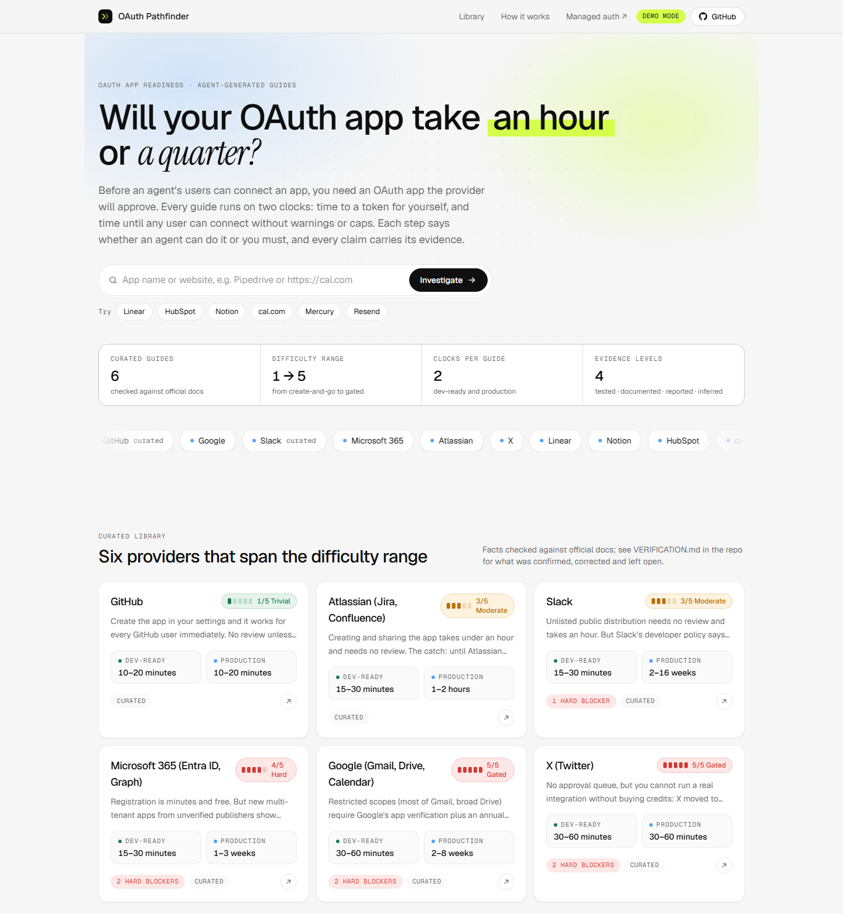
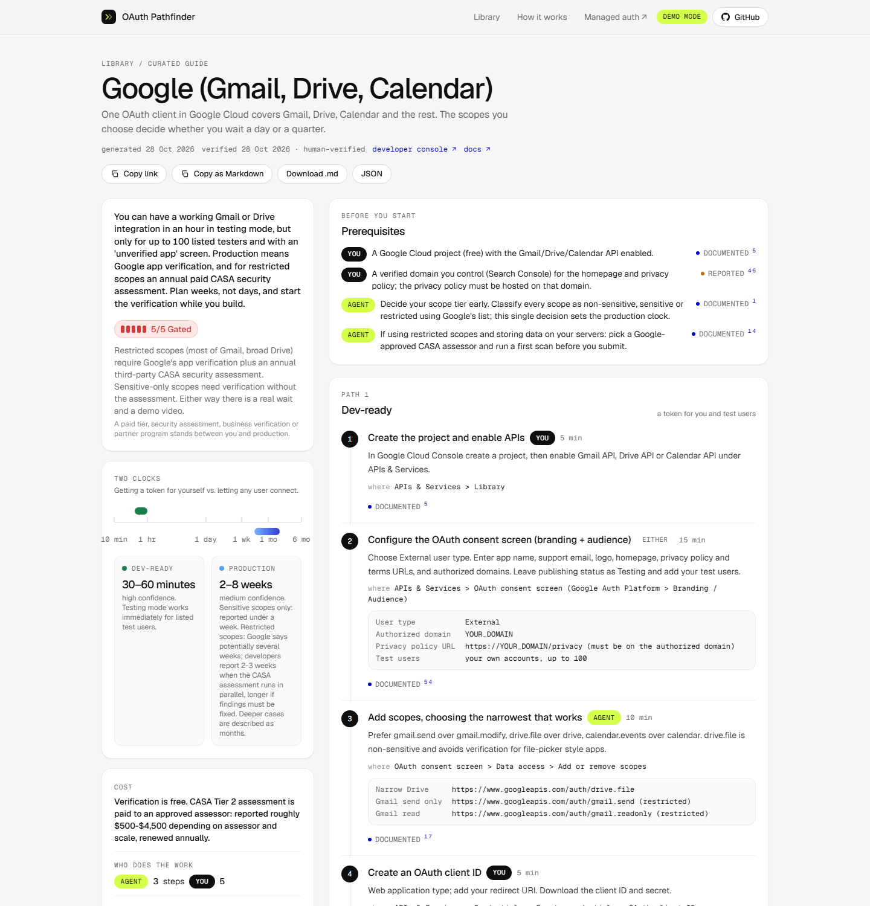
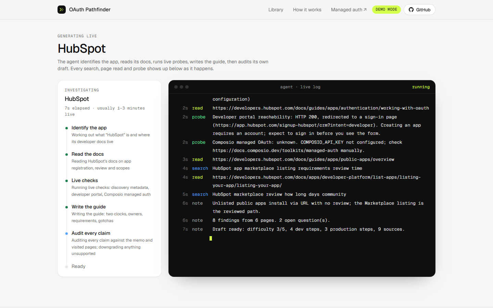
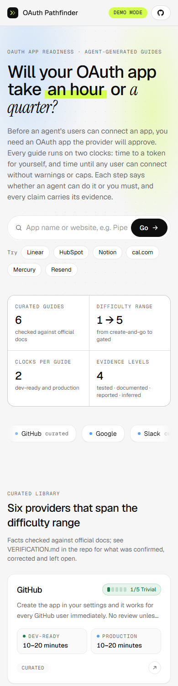
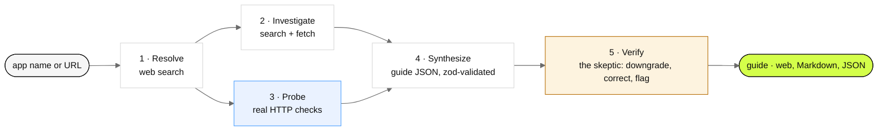

<p align="center">
  
</p>

<p align="center">
  <a href="https://oauth-pathfinder-blue.vercel.app"></a>
  <a href="https://github.com/bhuvan0808/oauth-pathfinder"></a>
  
</p>
<p align="center">
  
  
  
  
  
</p>

**Live:** https://oauth-pathfinder-blue.vercel.app · **Repo:** https://github.com/bhuvan0808/oauth-pathfinder · **Evidence:** [VERIFICATION.md](./VERIFICATION.md) · **For evaluators:** [SUBMISSION.md](./SUBMISSION.md) · **All docs:** [docs/README.md](./docs/README.md) · **For agents:** [AGENTS.md](./AGENTS.md), [/llms.txt](https://oauth-pathfinder-blue.vercel.app/llms.txt)

Before an AI agent's users can connect an app, the developer usually has to register an OAuth app with the provider and sometimes get it approved. The real question developers ask is not "how do I create the app" but **"will this take an hour or a quarter, and what is going to block me?"** OAuth Pathfinder answers that question per provider: a curated library of readiness guides, plus an agent that investigates any app you name and produces a shareable guide live.

Submitted for the Composio APM Integrations take-home.

> [!IMPORTANT]
> **The deployed site runs in demo mode.** No Anthropic API key was available at deploy time, so live generation runs on fixture responses for eleven apps (Linear, Notion, HubSpot, Cal.com, Mercury, Resend, Zoom, Discord, Dropbox, Salesforce, Stripe) and a deliberately low-confidence generic guide for everything else. The probe stage still makes real HTTP requests. Every generated guide says so with a **Demo mode** badge.
>
> **Built for any app.** Nothing in the pipeline is specific to those apps: it resolves a name or URL with web search, reads the provider's docs with web fetch, probes the domain, writes the guide against the schema and audits it. Set `ANTHROPIC_API_KEY`, remove `MOCK_AGENT`, redeploy, and the same code researches any provider live; see [Switching to live research](#switching-the-deployment-to-live-research). That path is complete but not yet exercised against the model, which [docs/TESTING.md](./docs/TESTING.md) states plainly along with the first-run checklist.

<table>
  <tr>
    <td width="50%" valign="top"><br><sub><b>Home.</b> Submit any app or pick a curated guide. The library spans difficulty 1 (GitHub) to 5 (Google, X).</sub></td>
    <td width="50%" valign="top"><br><sub><b>A guide.</b> TL;DR, difficulty, the two clocks on one log-scale bar, blockers, and steps with an owner and evidence badge each.</sub></td>
  </tr>
  <tr>
    <td colspan="2"><br><sub><b>Live generation.</b> Five stages streamed over SSE; every search, page read and probe appears as it happens.</sub></td>
  </tr>
</table>

<details>
<summary>Phone layout</summary>
<p align="center"></p>
</details>

## What a guide gives you

Every guide, curated or live-generated, has the same shape:

| Section | What it answers |
|---|---|
| **TL;DR + difficulty (1–5)** | The thing you screenshot for your team. 1 = create app, done. 5 = a paid tier, security assessment, business verification or partner program stands between you and production. |
| **Two clocks** | *Dev-ready*: time until you can get a token for yourself. *Production*: time until any user can connect without caps, warnings or admin consent, including approval waits. Shown on one log-scale bar so the gap is obvious. |
| **Blockers** | Hard (cannot ship without) vs soft (slows you). |
| **Path 1 / Path 2** | Steps to dev-ready, then steps to production. Each step is labelled **Agent** (research, drafting values, choosing scopes, writing justifications) or **You** (login, terms, payment, business verification, recording a video, clicking submit), with effort, console location and pre-filled values. |
| **Requirements, gotchas, when stuck** | Privacy policy, verified domain, demo video, assessments; the traps; the escalation path. |
| **Evidence on every claim** |  actually attempted ·  official docs, linked ·  community or vendor posts ·  the agent's best reading; verify. |
| **What we could and couldn't verify** | Corrections made during the audit pass, items left as inferred, open questions. |

Guides are shareable by URL, as Markdown (`/api/guides/<slug>?format=md`, paste into Slack, Notion or an agent's context) and as JSON (`/api/guides/<slug>`).

## Quick start

```bash
git clone https://github.com/bhuvan0808/oauth-pathfinder.git && cd oauth-pathfinder
npm install
cp .env.example .env.local      # add ANTHROPIC_API_KEY, or set MOCK_AGENT=1 for demo mode
npm run dev                     # http://localhost:3000
```

| Command | What it does |
|---|---|
| `npm run guide:validate` | Schema and integrity check on every curated guide (run in CI). |
| `npm run guide:linkcheck` | Fetches every source URL in the curated guides and reports dead links. |
| `npm run guide:generate -- "Pipedrive"` | CLI generation into `data/candidates/` for review (gitignored). |
| `npm run guide:generate -- https://cal.com --promote` | Writes straight into `data/guides/`. |
| `MOCK_AGENT=1 npm run guide:generate -- Linear` | Demo-mode run; watch the retry, source-dropping and audit paths. |

> [!TIP]
> **No API key?** Set `MOCK_AGENT=1` in `.env.local`. Fixtures exist for Linear, Notion, HubSpot, Cal.com, Mercury, Resend, Zoom, Discord, Dropbox, Salesforce and Stripe (every cited URL checked to resolve on 30 Oct 2026; written by hand rather than fetched by a model, see VERIFICATION.md section 5). Any other app gets a deliberately low-confidence guide where every claim is *inferred*. The Linear fixture includes a broken first draft, an invented source and a wrongly owned step so the retry, source-dropping and audit paths run on every demo.

### Environment variables

| Variable | Required | Purpose |
|---|---|---|
| `ANTHROPIC_API_KEY` | for live research | Resolve, investigate, synthesize and verify calls with server-side `web_search` and `web_fetch`. |
| `ANTHROPIC_MODEL` | no | Model override; default `claude-sonnet-4-5`. Must support both server tools. |
| `MOCK_AGENT=1` | no | Fixture responses instead of the model. Set on the deployed demo. |
| `COMPOSIO_API_KEY` | no | Lets the probe stage ask Composio whether it already provides a managed OAuth app for the toolkit. |
| `UPSTASH_REDIS_REST_URL` / `_TOKEN` | no | Persistent cache for live-generated guides; otherwise in-memory per instance. |
| `GENERATE_KEY` | no | Shared secret to gate `/api/generate` on a public deployment. |
| `GENERATE_RATE_LIMIT` | no | Generations per hour per IP; default 6, set to 10 on the deployment. |

### Switching the deployment to live research

```bash
printf '%s' "$ANTHROPIC_API_KEY" | vercel env add ANTHROPIC_API_KEY production
vercel env rm MOCK_AGENT production --yes
vercel --prod
```

The `/api/generate` route declares `maxDuration = 300`; Vercel accepted that on the Hobby plan (Fluid Compute allows up to 300 s), so a 1–3 minute live run fits. Without Upstash, live-generated guides are cached in memory per serverless instance. In demo mode a cache miss rebuilds the fixture guide on the fly so links keep working; with a real key you want Upstash so guides survive cold starts. Curated guides are files and always load.

## How a guide is generated



1. **Resolve.** One model call with web search: canonical name, website, docs, developer console, whether OAuth exists at all. Handles URLs and ambiguous names ("Mercury").
2. **Investigate.** A model call with Anthropic's server-side `web_search` and `web_fetch` tools answers ten questions (registration, flows, dev-mode limits, production gate, scope tiers, review requirements, timing and cost, blockers, rate limits, oddities). It returns a memo of findings, each with its evidence level and URLs.
3. **Probe.** Deterministic checks that need no account, run in parallel with step 2: `/.well-known/oauth-authorization-server` and `openid-configuration` (is there RFC 8414 metadata, and does it advertise **dynamic client registration**, the MCP-style path where no manual app is needed?); developer-portal reachability (does it redirect to a login wall?); and a Composio API lookup (does Composio already provide a **managed OAuth app**, so the developer can skip all of this?).
4. **Synthesize.** The memo, probes and the list of URLs the pipeline actually visited go into one call that writes the guide JSON. Output is validated with zod; a failed draft is retried once with the validation errors.
5. **Verify.** A second model call audits every claim against the memo and the visited-URL list. Anything "documented" without a supporting finding is downgraded to "inferred"; sources with URLs the pipeline never saw are removed; steps that claim an agent can do something requiring login or payment are reassigned to "you". The corrections are shown in the guide, not hidden.

The UI streams each stage and every search, fetch and probe over SSE so you can watch the investigation. A full live run takes 1–3 minutes and roughly 12 searches, 8 fetches and 5 model calls. A demo-mode run takes about 8 seconds.

## API

Everything the UI shows is available to code and to agents. Full reference with examples: [docs/API.md](./docs/API.md).

| Endpoint | What you get |
|---|---|
| `GET /api/health` | Mode (demo / live), configuration flags, curated slugs, demo apps, endpoint list. No secrets. |
| `GET /api/guides` | Index of every guide with difficulty, both clocks, blockers, verification status and links. |
| `GET /api/guides/{slug}` | One guide as JSON ([schema](./docs/guide.schema.json)). |
| `GET /api/guides/{slug}?format=md` | The same guide as Markdown with evidence and sources intact. |
| `POST /api/generate` `{"query": "…"}` | Server-Sent Events for a new guide; the `done` event carries the full guide. Cached guides return JSON instantly. |
| `GET /llms.txt` | Plain-text orientation for agents. |

## Evaluate it in three minutes

1. Open the [home page](https://oauth-pathfinder-blue.vercel.app) and read the two-clocks framing; the library spans 1 → 5.
2. Open [Google (Gmail, Drive, Calendar)](https://oauth-pathfinder-blue.vercel.app/guide/google-gmail): TL;DR, two-clocks bar, hard blockers, Path 2 with owners, evidence badges, and the "could and couldn't verify" section.
3. Type **Mercury** (ambiguous), **Resend** (API key only) or any app you like, and watch the stages and the search / read / probe log stream. Land on the generated guide; find an *inferred* badge and the corrections list.
4. Click **Copy as Markdown** and paste it somewhere. Then read [VERIFICATION.md](./VERIFICATION.md) for what was checked against real sources, corrected, and left open.

## What was tested

Re-run on 30 Oct 2026 after the UI rewrite and deployment.

- `npm run typecheck`, `npm run guide:validate` and `npm run build` pass.
- Full pipeline in demo mode via the CLI, one run per app. Probes are live HTTP calls; everything else is fixture. Durations include the deliberate fixture delays that make the streamed log readable.

  | Input | Difficulty | Dev-ready | Production | Sources | Duration | Notes |
  |---|---|---|---|---|---|---|
  | Linear | 1/5 | 10–15 min | 10–15 min | 6 | 8 s | First draft fails validation and is retried; invented source dropped; "submit for review" step removed by the audit. |
  | HubSpot | 3/5 | 30–60 min | 2–4 weeks | 9 | 8 s | Marketplace listing path; unlisted install URL noted as the no-review alternative. |
  | https://cal.com | 3/5 | 1–2 h | 1–7 days | 7 | 7 s | URL input resolves to Cal.com; flags that Platform OAuth clients create managed users, not consent for existing accounts. |
  | Mercury | 4/5 | 10–20 min | 2–8 weeks | 6 | 8 s | Ambiguous name; resolve stage states why it picked the bank. Production is an approval form plus GPG credential exchange. |
  | Resend | 1/5 | 5–10 min | 1–48 h | 7 | 7 s | `supportsOAuth: false`; validates; production clock is DNS verification, not approval. |
  | Notion | 2/5 | 15–30 min | 1–2 h | 7 | 7 s | Public integration form; no review before users can connect. |
  | Zoom | 4/5 | 30–60 min | 2–6 weeks | 8 | 8 s | Unpublished apps stay inside your account; Marketplace review gates everyone else. |
  | Discord | 2/5 | 10–20 min | 10–20 min | 7 | 7 s | OAuth2 is instant; bot verification is the long clock, stated as such. |
  | Dropbox | 3/5 | 15–30 min | 3–14 days | 7 | 7 s | Development status caps users; production approval is a short real review. |
  | Salesforce | 2/5 | 20–40 min | 20–40 min | 7 | 9 s | Self-serve connected app with the 2–10 minute propagation gotcha; AppExchange separate. |
  | Stripe | 3/5 | 15–30 min | 1–3 days | 7 | 7 s | Connect-only OAuth; the gate is account activation, not a review. |
  | Fathom Analytics (no fixture) | 3/5 | 1–4 h | 1–4 weeks | 0 | 6 s | Generic fallback: low confidence, every claim inferred, status stays `unverified`, no crash. |

- **SSE streaming.** On `next dev` and on the production deployment, `curl -N` receives events roughly 300 ms apart from the first stage onwards, so the browser log animates live rather than arriving at the end.
- **Production checks** on https://oauth-pathfinder-blue.vercel.app: `/` lists the six curated guides; `/guide/google-gmail` renders the two clocks, blockers, both paths and sources; `/api/guides/slack?format=md` returns `text/markdown`; `POST /api/generate {"query":"Linear"}` streams to `done` in about 9 s and `/guide/linear` then loads; `{"query":"Slack"}` returns `{"cached":true,"tier":"library"}` in under a second.
- **Found and fixed on the deployed site.** The guide page returned 404 right after a successful generation because the in-memory cache is per serverless instance. In demo mode `getGuide` now rebuilds a missing live guide with the fixture delays skipped (about one second); with a real key the fix is Upstash. The generate route's cache check deliberately does not rebuild, so a fresh request still streams the whole run.
- **Link check.** All 47 source URLs in the curated guides resolve. Three had moved (Microsoft Tech Community post, the X pay-per-use agreement, a community X API post) and were updated; Google's support page and the Tech Community post answer HEAD with 4xx but GET with 200, so the checker now retries with GET and browser headers.
- **Layout** checked in headless Edge at 1440 px and inside a 390 px frame: the only breakage found (long callback and scope URLs widening the guide grid on phones) was fixed with `min-width: 0` on the grid children.
- **Not tested against the live model.** No `ANTHROPIC_API_KEY` was available, so the SDK event names for server tools, the `web_fetch` beta header and real-model JSON drift are still unverified. See [CLAUDE.md](./CLAUDE.md) for that checklist; the fixtures were written to the same prompts and schema the live path uses.

## Key decisions

**Two clocks, not one.** Most "how to set up OAuth for X" content stops at the client ID. The gap between dev-ready and production is where launches slip: Google's CASA assessment, Microsoft's publisher verification, Slack's Marketplace review, X's prepaid credits. Making the production clock a first-class field forces every guide to answer the real question.

**Owners on every step.** The brief asks what an agent can do and where the human takes over. Rather than a paragraph, each step carries `owner: agent | you | either`, and the summary counts them. In practice agents can do most of the preparation (scope minimisation, privacy-policy and justification drafts, demo-video scripts, manifests) and almost none of the gates (login, terms, business vetting, payment, submit).

**Evidence is a field, not a footnote.** Timing and cost claims are the most useful and the least reliable, so the schema makes the level explicit and the integrity checker refuses "documented" claims without a source. "Tested" is reserved for things actually attempted; the pipeline's probes earn it, model reasoning never does.

**Verify in a separate pass with a narrower job.** Asking the same call to write and self-audit produces confident prose. The verifier is told it is the skeptic and may only downgrade, correct or flag. Its corrections are surfaced in the guide so readers see the audit trail.

**Pipeline bans invented URLs.** Only URLs returned by search or fetched by the tools can appear as "documented" or "reported" sources. Hallucinated console paths were the single biggest failure in early tests; this rule plus the integrity checker removed almost all of them.

**Shortcuts first.** If Composio manages the OAuth app, or the provider advertises dynamic client registration, the guide says so at the top. Telling a developer they can skip the whole process is the most useful possible answer.

**A focused library, not 100 shallow guides.** Six curated guides chosen to span the difficulty range and the different kinds of gate:

| Guide | Difficulty | Why it is in the set |
|---|---|---|
| GitHub |  | Baseline: create app, works for everyone, no review. Includes two real probes. |
| Atlassian (Jira/Confluence) |  | Instant sharing with a privacy policy, but an "unreviewed app" warning until Marketplace review. |
| Slack |  | Unlisted distribution is a switch; policy pushes commercial apps into a reported months-long Marketplace review. |
| Microsoft 365 / Entra |  | No review queue at all; the wait is Partner Center company vetting and a verified domain. |
| Google (Gmail/Drive) |  | Restricted scopes: verification plus an annual paid CASA assessment. The canonical "weeks" case. |
| X (Twitter) |  | No review, but gated by money: pay-per-use credits, no free tier for ordinary apps. |

The same pipeline generates the rest: `npm run guide:generate` writes candidates into `data/candidates/` for review, which is how a 100-app library would be built in batches and promoted after a human diff.

**Borrowed Composio's visual language.** The palette (near-white page, white hairline cards, brand blue, lime highlight), mono uppercase labels, pill buttons and the marquee, shimmer and terminal-cursor motion are modelled on composio.dev, since that is who the guides are for.

## What was checked against real sources

See [VERIFICATION.md](./VERIFICATION.md). Summary: the gating claims in all six curated guides (CASA and its 12-month renewal; Slack's Dec 2024 policy and May 2025 terms; Atlassian's private-by-default and unreviewed warning; Microsoft's MPN requirement and B2C exclusion; X's pay-per-usage model) are confirmed on official pages fetched on 28 Oct 2026. Corrections made along the way are listed there and inside each guide. Form-level details that rely on integrator walkthroughs are labelled "reported", and a few stable doc pages cited from memory are flagged as such. Section 5 covers what was and was not verified for the demo fixtures.

## Limitations

- **The deployed demo is not live research.** `MOCK_AGENT=1` is set on Vercel. Eleven apps have hand-written fixtures; everything else gets a generic all-inferred guide. The UI says so on every generated guide. Add an Anthropic key to switch the same pipeline to real web search and fetch.
- **Timing estimates are mostly "reported".** Providers rarely publish review durations. The guides say so and give ranges with confidence levels rather than a single number.
- **"Tested" is thin.** The pipeline's probes are real but shallow (metadata, portal reachability, Composio status). Actually clicking through a provider's "create app" form needs an account and a browser agent; that was out of scope for the time budget. The manual setup attempts in VERIFICATION.md section 4 are the only end-to-end tests.
- **Policies drift.** X changed its pricing model twice in 2026; Google's restricted-scope list moves. Every guide carries a `lastVerifiedAt` and the pipeline can regenerate on demand (`?force=1`).
- **Live generation is not human-reviewed.** Agent-verified guides are labelled as such and should be read with the evidence badges in view.
- **Cost and abuse controls are minimal.** Per-IP rate limiting is in-memory (`GENERATE_RATE_LIMIT=10` per hour on the deployment); `GENERATE_KEY` can gate the endpoint for a public demo. Expect roughly $0.30–$0.80 per live generation depending on how much the model reads.
- **Composio status needs a key.** Curated guides ship with `composioManaged: unknown` rather than asserting something that was not checked; the page fills it in live when `COMPOSIO_API_KEY` is set.

## Documentation

The full set lives in [docs/README.md](./docs/README.md), organised by reader.

| Reader | Start with |
|---|---|
| Evaluator | [SUBMISSION.md](./SUBMISSION.md) |
| Manager or product | [docs/EXECUTIVE_SUMMARY.md](./docs/EXECUTIVE_SUMMARY.md), [docs/DECISIONS.md](./docs/DECISIONS.md), [docs/ROADMAP.md](./docs/ROADMAP.md) |
| Developer | [docs/ARCHITECTURE.md](./docs/ARCHITECTURE.md), [docs/API.md](./docs/API.md), [docs/GUIDE_SCHEMA.md](./docs/GUIDE_SCHEMA.md), [docs/DEPLOYMENT.md](./docs/DEPLOYMENT.md), [docs/TESTING.md](./docs/TESTING.md) |
| Fact checker | [VERIFICATION.md](./VERIFICATION.md) |
| AI agent | [AGENTS.md](./AGENTS.md), [/llms.txt](https://oauth-pathfinder-blue.vercel.app/llms.txt), [docs/guide.schema.json](./docs/guide.schema.json) |
| Anyone with a question | [docs/FAQ.md](./docs/FAQ.md), [CHANGELOG.md](./CHANGELOG.md) |

## Repository layout

```
app/                   Next.js App Router: home, /guide/[slug], /generate, API routes (generate, guides, health)
components/            GuideView, TwoClocks, Badges, ProgressLog, SubmitBox, LibraryGrid, CopyButton
lib/schema.ts          Zod schema: the contract for agent output, curated data, UI and export
lib/agent/             client (Anthropic tools), prompts, probe, pipeline, json, mock + mockFixturesExtra (demo fixtures)
lib/store.ts           Curated library loader + live cache (Upstash or memory, demo rebuild on miss)
lib/markdown.ts        Shareable Markdown export
data/guides/*.json     Curated, human-verified guides
scripts/               generate (CLI), validate, linkcheck
public/llms.txt        Agent-facing summary served by the site
docs/                  Documentation set, JSON Schema, banner, screenshots, manual-attempt evidence
AGENTS.md              Repository map for AI agents and new contributors
VERIFICATION.md        What was checked, corrected, and could not be verified
SUBMISSION.md          Evaluator note: links, what to click, what is demo vs real
CHANGELOG.md           What changed when
```

<p align="center"><sub>MIT licensed · built with Next.js 14, TypeScript, Tailwind, zod and the Anthropic SDK</sub></p>
