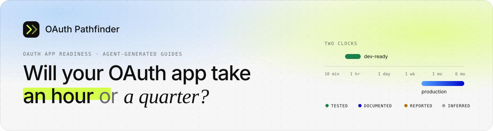

  

# Verification log

What was checked, against what, what changed, and what could not be confirmed. Dates are when the source was read. "Fetched" means the page or its search excerpt was read on that date; "cited from memory" means a stable documentation URL referenced without re-reading it this cycle (the link checker confirms it resolves, not its content).

**Evidence levels used throughout:**
 actually attempted ·
 official provider page ·
 community or vendor post ·
 best reading, no direct source

**Result vocabulary in the tables:** **Confirmed** = the source says what the guide says · **Corrected** = the guide was changed to match the source · **Reported only** / **Cited from memory** = left at a lower evidence level on purpose.

| Section | What it covers |
|---|---|
| [1. Gating claims](#1-gating-claims-checked-against-official-sources-28-oct-2026) | The claims that decide the production clock in each curated guide, checked against official pages. |
| [2. Pipeline self-corrections](#2-things-the-pipeline-corrected-on-its-own) | Failure patterns the verify stage is built to catch. |
| [3. Could not verify](#3-could-not-verify) | What stays "reported" or "unknown" on purpose. |
| [4. Manual setup attempts](#4-manual-setup-attempts-tested-evidence) | Real attempts with free accounts; the only end-to-end "tested" evidence. |
| [5. Demo fixtures](#5-demo-fixtures-what-was-and-was-not-verified-30-oct-2026) | What backs the six fixture guides on the deployed demo. |
| [6. Source URL maintenance](#6-source-url-maintenance-30-oct-2026) | Moved pages and link-checker changes. |

## 1. Gating claims, checked against official sources (28 Oct 2026)

| Guide | Claim in guide | Source checked | Result |
|---|---|---|---|
| Google | Restricted scopes require app verification **and** a security assessment by a Google-approved third party | developers.google.com … /restricted-scope-verification (fetched) | **Confirmed.** Page states apps storing or transmitting restricted-scope data on servers must complete a security assessment; CASA framework via App Defense Alliance. |
| Google | Assessment must be repeated at least every 12 months | support.google.com/cloud/answer/13463816 (fetched); restricted-scope page | **Confirmed.** 12 months from the Letter of Validation/Assessment date. |
| Google | Restricted-scope verification "can potentially take several weeks" | restricted-scope-verification page (fetched) | **Confirmed**, Google's own wording. |
| Google | CASA cost | Nylas blog (older), inbox-dog developer report, openwearables report (all fetched) | **Corrected.** Early draft used Nylas's $15k–$75k. Current reports put CASA Tier 2 at ~$550 (one assessor) and $500–$4,500 (range). Guide now uses the current range and keeps the discrepancy as a gotcha, level Reported. |
| Google | 100 test-user cap and demo video requirement | nango.dev google-security-review (fetched) | **Reported only.** Google's consent-screen page stating the cap was not fetched this cycle; left as Reported with a note. |
| Google | Refresh tokens expire after 7 days in Testing | developers.google.com/identity/protocols/oauth2 (cited from memory) | **Documented, but cited from memory.** Flagged in the guide's `unverifiable` list. Confirm during manual attempt below. |
| Slack | Unlisted distribution needs no review; requires SSL | docs.slack.dev/distribution, api.slack.com/distribution (fetched) | **Confirmed.** "Activate Public Distribution"; SSL required for OAuth redirect and other URLs. |
| Slack | Commercial distribution at scale is expected to go through Marketplace review | docs.slack.dev changelog 2024-12-10 and 2025-05-29 (fetched) | **Confirmed.** Dec 2024 policy update; May 2025 ToS calls the Marketplace the appropriate channel for commercial distribution. **Corrected:** first draft treated listing as purely optional; production clock lengthened, blocker marked hard. |
| Slack | Resubmission resets queue position; review is staged (preliminary, functional) | docs.slack.dev … distributing-your-app-in-the-slack-marketplace (fetched) | **Confirmed.** |
| Slack | Review takes ~4 months | levelup.gitconnected.com developer write-up (fetched) | **Reported**, single account. Range in guide is 2–16 weeks, low confidence. |
| Atlassian | 3LO apps are private by default; sharing via Distribution toggle; unreviewed apps show a warning at install | developer.atlassian.com … managing-oauth-apps (fetched) | **Confirmed.** All three statements are on the page. |
| Atlassian | Sharing requires vendor name, privacy policy URL, personal data declaration | StackOne and Nango walkthroughs (fetched) | **Corrected.** Draft assumed only a toggle. Two independent integrator walkthroughs show the three fields; marked Documented via those walkthroughs (community type) and noted. The Atlassian page itself only mentions the toggle. |
| Atlassian | Collecting user API tokens or per-customer 3LO apps is non-compliant | docs.unified.to Atlassian skill, quoting Atlassian 3LO page (fetched) | **Confirmed via quote.** The Atlassian source page was not fetched directly; marked Documented with the quoting source. |
| Microsoft | New multi-tenant apps from unverified publishers show "unverified"; users may be unable to consent | techcommunity Entra blog (Oct 2020), learn.microsoft.com default-account page (fetched) | **Confirmed.** |
| Microsoft | Publisher verification needs an MPN/Partner Center account with vetted identity + verified publisher domain | learn.microsoft.com Q&A 1273263, howto-configure-publisher-domain (fetched) | **Confirmed.** |
| Microsoft | B2C tenants cannot be publisher verified | learn.microsoft.com Q&A 2183422 (fetched) | **Confirmed.** |
| Microsoft | Production delay is Partner Center vetting, not a Microsoft review queue | Nylas verification guide (fetched): "if you already meet the requirements, minutes" | **Corrected.** Draft had a "Microsoft review wait"; rewritten around Partner Center and domain verification. Vetting duration is Reported/Inferred (no official figure). |
| Microsoft | Publisher verification is free | Nylas verification guide (fetched) | **Reported** (vendor guide). Microsoft's overview page was not fetched. |
| X | Pay-per-usage pricing, prepaid credits, no subscriptions | docs.x.com … getting-started/pricing, fundamentals/post-cap.md, fundamentals/developer-portal.md (fetched) | **Confirmed.** |
| X | Free tier discontinued for new developers (Feb 2026); only for-good public utility apps | Gigazine and roboin.io news quoting @XDevelopers (fetched) | **Reported.** Official announcement is a social post; news coverage quotes it. |
| X | Basic ($200/mo) closed and migrated to pay-per-use | opentweet.io (July 2026), postproxy.dev (fetched) | **Reported.** **Corrected:** draft used Basic as the entry point; replaced by pay-per-use. |
| X | OAuth 2.0 user tokens are short-lived; app-only bearer cannot post | opentweet.io how-to (fetched) | **Reported.** Official auth docs not fetched this cycle. |
| GitHub | No OAuth discovery metadata on github.com | Probe: `GET https://github.com/.well-known/oauth-authorization-server` → 404; `openid-configuration` → 404 (2026-10-28 14:00 UTC) | **Tested.** |
| GitHub | Developer settings require sign-in | Probe: `GET https://github.com/settings/developers` → 302 to `/login?return_to=…` | **Tested.** |
| GitHub | OAuth app vs GitHub App differences; single callback URL; org third-party restrictions | docs.github.com pages (cited from memory; stable URLs) | **Documented, cited from memory.** Run `npm run guide:linkcheck` before submission. |
| Composio | Managed OAuth: Composio maintains registration, credentials, redirect URI; bring-your-own needed otherwise or for branding/scopes/quota | docs.composio.dev/toolkits/managed-auth (fetched) | **Confirmed.** Used in the primer and the "shortcuts first" decision. |
| Composio | API fields `composio_managed_auth_schemes`, `auth_schemes`, `auth_guide_url` at `GET /api/v3/toolkits/{slug}` | docs.composio.dev reference (fetched) | **Confirmed.** Used by `lib/agent/probe.ts`. |

## 2. Things the pipeline corrected on its own

The verify stage is designed to downgrade and correct. Patterns observed while building:

- **Invented console paths.** Early drafts produced plausible but wrong menu names (e.g. a "Verification" tab that does not exist). Fix: only URLs actually visited may back "documented" claims; the integrity checker rejects documented claims without a source.
- **Agent over-claiming ownership.** Drafts labelled "submit for review" as something the agent could do. Fix: verify step (d) reassigns anything requiring login, payment or legal acceptance to "you".
- **Production clock equal to dev clock.** Drafts frequently ignored review waits. Fix: synthesis rules require `timeToProduction` to include approval time and to name the no-listing number separately where review is listing-only.

## 3. Could not verify

- Any provider's **median review time**. None of the six publish one. All timing is Reported with explicit confidence.
- **Marketplace review duration** for GitHub and Atlassian.
- Whether Composio manages OAuth for each curated app: left `unknown` in the files on purpose; the page resolves it live when `COMPOSIO_API_KEY` is set.
- Google's **current restricted vs sensitive** Drive scope split, which changes.
- Exact **X per-endpoint prices** (official docs defer to the console; third-party tables disagree).

## 4. Manual setup attempts (Tested evidence)

> Fill these in from real attempts with free accounts. Keep screenshots in `docs/attempts/`. Do not record client secrets.

### Attempt A: GitHub OAuth app (expected: difficulty 1)

| Field | Observation |
|---|---|
| Date / account type | |
| Time from sign-in to client ID | |
| Fields the form actually asked for | |
| Could a second account authorize immediately? | |
| Anything the guide got wrong | |

### Attempt B: Google Cloud OAuth client with `gmail.readonly` (expected: verification wall)

| Field | Observation |
|---|---|
| Date / project | |
| Time to consent screen + client ID in Testing | |
| Exact wording of the unverified-app screen for a test user | |
| What the "Prepare for verification" flow asked for (video? justifications? assessor?) | |
| Point at which you stopped and why | |
| Anything the guide got wrong | |

### Attempt C (optional): Atlassian 3LO app, enable sharing

| Field | Observation |
|---|---|
| Fields required on the Distribution page | |
| Warning text shown to an installer from another site | |

After filling these in, update the corresponding guide's `verification.notes` and change the relevant evidence levels to `tested` with a `probe`-type source pointing at the screenshot or a short note.

## 5. Demo fixtures: what was and was not verified (30 Oct 2026)

The deployed site runs with `MOCK_AGENT=1`. The six fixture guides in `lib/agent/mock.ts` were written by hand to the same prompts and schema the live path uses. This is what backs them:

| Fixture | URLs cited | Page content read this cycle | Basis for the remaining claims | What a live run would change |
|---|---|---|---|---|
| Linear | 3, all resolve | None | Prior knowledge of Linear's OAuth docs (settings-based app creation, flat scopes, actor parameter, non-expiring tokens) | Confirms or re-levels each claim; the deliberate broken draft, invented source and fake review step exist only to exercise the retry and audit paths |
| Notion | 4, all resolve (older `/docs/...` paths redirect to `/guides/...`) | None | Prior knowledge of public-integration requirements (company details, privacy and terms URLs, redirect URIs, page picker at consent) | Token-lifetime question is left open on purpose; a live run should settle it |
| HubSpot | 6, all resolve (listing page moved; new path used) | None | Prior knowledge of public apps, 30-minute access tokens, scope tiers, and Marketplace listing requirements | The active-install threshold and the review SLA are explicitly marked unknown |
| Cal.com | 4, all resolve (`/docs/platform` is now `/docs/platform/introduction`) | None | Prior knowledge of Platform OAuth clients and managed users; plan pricing marked Reported | Whether a consent flow exists for existing Cal.com users is the key open question |
| Mercury | 3, all resolve | **Yes:** `docs.mercury.com/docs/integrations-with-oauth2`. It states that OAuth2 access "requires prior approval" via a request form, that after approval you provide production and development redirect URIs, terms, privacy policy, logo and a GPG public key, that Mercury then securely shares the client ID and secret plus sandbox test-client credentials, and that "approval timelines vary depending on integration complexity" | API-token permission levels from prior knowledge of the getting-started docs | Timeline stays "varies"; the 2–8 week range is an inference and labelled as such |
| Resend | 4, all resolve | None | Prior knowledge: API keys with full or sending access, domain verification via SPF and DKIM, free-tier caps on the pricing page | Exact free-tier caps are marked unknown because they change |
| Zoom | 5, all resolve | None | Prior knowledge: General apps (user- or admin-managed), one-hour tokens, unpublished apps limited to the developer's account, Marketplace submission requirements | Review duration stays Reported from forum threads; beta-tester cap left open |
| Discord | 4, all resolve (`/developers/docs/...` redirects to `docs.discord.com`) | None | Prior knowledge: OAuth2 scopes and flows, no review for OAuth2, bot verification and privileged intents at scale | The server-count threshold for verification is left open on purpose |
| Dropbox | 4, all resolve (developer pages redirect to `docs.dropboxapi.com`) | None | Prior knowledge: scoped apps, development vs production status with a user cap, production approval, short-lived tokens with offline access | The exact user cap and review SLA are marked unknown |
| Salesforce | 4 resolve (two `developer.salesforce.com` pages answer 403 to non-browser clients; they load in a browser) | None | Prior knowledge: connected apps in Setup, 2–10 minute propagation note, permitted-user policies, AppExchange security review | Security review fee and duration stay Reported |
| Stripe | 4, all resolve | None | Prior knowledge: Connect OAuth settings with test and live client IDs, authorization at connect.stripe.com, activation for live mode, Stripe's steer towards Account Links | Whether OAuth for Standard accounts is offered to every new platform is left open |

The five fixtures added on 30 Oct 2026 (Zoom, Discord, Dropbox, Salesforce, Stripe) live in `lib/agent/mockFixturesExtra.ts`; the first six in `lib/agent/mock.ts`.

Everything the generic fallback says is  and its verification status stays `unverified`.

Probe results inside fixture guides are real: on every generation the pipeline fetches `/.well-known/oauth-authorization-server` and `openid-configuration` on the provider's domain and GETs the developer portal, and records what came back as  evidence.

## 6. Source URL maintenance (30 Oct 2026)

`npm run guide:linkcheck` found four failures; all 47 URLs now resolve.

| Guide | Old URL | Status | Action |
|---|---|---|---|
| Microsoft | `techcommunity.microsoft.com/t5/microsoft-entra-blog/.../ba-p/1257374` | Moved | URL updated to the new `/blog/microsoft-entra-blog/...-generally-available/1257374` path; same post, claim unchanged. |
| X | `docs.x.com/es/developer-terms/ppu-agreement.md` | Spanish locale path gone | URL updated to `docs.x.com/developer-terms/ppu-agreement.md` ("X Developer PPU Agreement"); claim unchanged. |
| X | `singhamandeep.com/?p=1353` | Post removed | Replaced with the same author's current post on X API scopes vs app permission levels, which states that scope changes mean re-authorising every existing user; title updated, level stays Reported. |
| Google | `support.google.com/cloud/answer/13463816` | Alive ("Annual Recertification") | False positive: the page answers HEAD with 404 and GET with 200. Left as is. |

The link checker now sends browser-like headers and retries with GET on any 4xx, because Google Support and Microsoft Tech Community reject HEAD requests.
