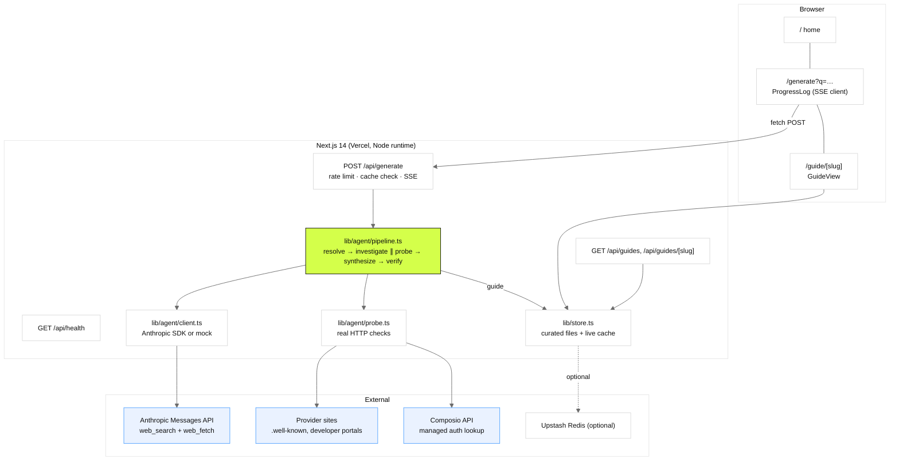

# Architecture

How OAuth Pathfinder is put together: runtime components, the two request flows, the five pipeline stages with their budgets, the event stream, storage, evidence rules, security and a file map.

## 1. Runtime components



- **Framework**: Next.js 14 App Router, TypeScript strict, Tailwind. All pages are dynamic (`force-dynamic`) so the curated library and the live cache are read per request.
- **Model access**: `@anthropic-ai/sdk` with Anthropic's server-side `web_search` and `web_fetch` tools, model `claude-sonnet-4-5` by default (`ANTHROPIC_MODEL` overrides). In demo mode (`MOCK_AGENT=1`) `client.ts` routes every model call to `mock.ts`.
- **Storage**: curated guides are JSON files in `data/guides/`, validated on load. Live guides go to Upstash Redis if configured, otherwise an in-memory `Map` scoped to the serverless instance.
- **Fonts and palette**: Geist Sans and Geist Mono (`geist` package), Instrument Serif (`next/font/google`); tokens in `tailwind.config.ts` and `app/globals.css`, modelled on composio.dev.

## 2. Request flows

### 2.1 Reading a guide

1. `GET /guide/{slug}` → `getGuide(slug)` in `lib/store.ts`.
2. Curated file hit → render. Otherwise live cache hit → render.
3. Demo mode only: on a miss, rebuild the fixture guide with delays disabled (`withoutMockDelays`) so deep links survive cold starts; probes still run. The generate route opts out of this rebuild so a fresh request still streams.
4. `enrichWithComposio` fills `oauth.composioManaged` at render time when `COMPOSIO_API_KEY` is set (3 s budget, never blocks).
5. `GuideView` renders; `guideToMarkdown` produces the copyable Markdown for the same request.

### 2.2 Generating a guide

1. Browser `POST /api/generate {"query"}` from `ProgressLog`.
2. Route validates input (1–200 chars), checks the optional `GENERATE_KEY`, returns `{cached: true, slug, tier}` as JSON if the guide already exists (unless `force`), applies the per-IP hourly limit, refuses if neither a key nor demo mode is configured.
3. Opens a `text/event-stream` and runs `generateGuide(query, emit)`; a `: keep-alive` comment every 15 s keeps proxies from closing the connection.
4. On success the guide is saved to the live cache; the final `done` event carries the whole guide so the client can navigate immediately.
5. `ProgressLog` parses `data:` lines incrementally and redirects to `/guide/{slug}` 1.1 s after `done`.

## 3. The five stages

| # | Stage | Model call | Budget | Input | Output |
|---|---|---|---|---|---|
| 1 | **Resolve** | `research` with web search | 3 searches, 1 fetch, 1500 tokens | the query | canonical name, website, docs URL, developer portal, category, `supportsOAuth`, auth methods seen, ambiguity note, confidence |
| 2 | **Investigate** | `research` with search + fetch | 8 searches, 6 fetches, 7000 tokens | resolved app | memo: 15–30 findings with topic, claim, evidence level, URLs, excerpt; `sourcesSeen`; `unknowns` |
| 3 | **Probe** (parallel with 2) | none | 6 s timeout per request | website, portal URL, name | discovery metadata (and `registration_endpoint`), portal reachability and login redirect, Composio managed-auth status |
| 4 | **Synthesize** | `complete` | 9000 tokens, up to 2 attempts | resolved + memo + probes + Composio + visited URLs | guide JSON; normalised, source-filtered, re-levelled, `parseGuide`-validated |
| 5 | **Verify** | `complete` | 9000 tokens | draft + memo + visited URLs | corrected guide with `verification` filled in, plus an audit log |

Stage prompts live in `lib/agent/prompts.ts`. They all share `DOMAIN_PRIMER`, which defines the two clocks, the owner rules and the evidence discipline so the vocabulary is identical across stages.

### Normalisation and integrity (stage 4)

Before strict parsing, `pipeline.ts`:

- forces `schemaVersion`, `slug`, `generatedBy`, timestamps and an empty `verification` block;
- cleans URLs on the app object, falling back to the resolve stage's values;
- **drops any source whose URL the pipeline never visited** (probe sources are exempt), then re-levels evidence that pointed at dropped sources to `inferred` with a note;
- runs `parseGuide`, which enforces the zod schema and the cross-field rule that every non-inferred evidence entry cites an existing source id.

A failed draft is retried once with the validation errors appended to the prompt. Two failures abort the run with an `error` event.

### The audit pass (stage 5)

The verifier is told it is the skeptic and may only downgrade, correct or flag: unsupported documented/reported claims become inferred; sources not in the visited list are removed; numbers inconsistent with the memo are fixed or marked inferred; steps that need login, payment or legal acceptance are reassigned to `you`; the production clock is reconciled with the production steps; the TL;DR is tightened. If the pass itself fails, the draft ships as `unverified` with a note rather than silently.

## 4. SSE event schema

Every event is one `data: <json>` line followed by a blank line.

```ts
type PipelineEvent =
  | { type: "stage";    stage: Stage; message: string }
  | { type: "activity"; stage: Stage; kind: "search" | "fetch" | "probe" | "note"; detail: string }
  | { type: "result";   stage: Stage; data: unknown }            // structured output of a stage
  | { type: "done";     guide: Guide; auditLog: string[]; stats: { searches, fetches, inputTokens, outputTokens } }
  | { type: "error";    stage: Stage; message: string };
type Stage = "resolve" | "investigate" | "probe" | "synthesize" | "verify" | "done" | "error";
```

Order: `stage resolve` → activities → `result resolve` → `stage investigate` and `stage probe` (parallel) → activities from both → `result investigate`, `result probe` → `stage synthesize` → notes → `stage verify` → note → `stage done` → `done`.

## 5. Probes

`lib/agent/probe.ts` never guesses: each probe records `yes`, `no` or `unknown` plus the observed detail, and becomes a `probe`-type source with `tested` evidence.

| Probe | Request | What it tells the developer |
|---|---|---|
| OAuth/OIDC discovery | `GET {origin}/.well-known/oauth-authorization-server`, then `/.well-known/openid-configuration` | Whether RFC 8414 metadata exists and whether a `registration_endpoint` (dynamic client registration, the MCP-style path) is advertised |
| Developer portal | `GET {developerPortalUrl}` following redirects | Reachable without auth, or redirected to a login wall (so an agent cannot create the app alone) |
| Composio managed auth | `GET backend.composio.dev/api/v3/toolkits?search=…` then `/toolkits/{slug}` (needs `COMPOSIO_API_KEY`) | Whether Composio already provides a managed OAuth app, so the developer may skip registration entirely |

## 6. Storage tiers and caching

| Tier | Where | Lifetime | Notes |
|---|---|---|---|
| Curated | `data/guides/*.json` | forever | Validated on load; invalid files are skipped with a console error, never served. |
| Live, Upstash | Redis key `guide:{slug}` + sorted index | persistent | Enabled by `UPSTASH_REDIS_REST_URL` and `_TOKEN`. |
| Live, memory | `Map` in the server process | until cold start or another instance | Default. Demo mode compensates by rebuilding on a miss. |

The generate route treats a curated or cached guide as free: no rate-limit hit, no model call.

## 7. Security and abuse controls

- The Anthropic key, Composio key and Upstash token are server-only; nothing is read from or written to browser storage.
- `GENERATE_KEY` (optional) gates `/api/generate` via `x-generate-key` header or `?key=`.
- `GENERATE_RATE_LIMIT` per IP per hour (default 6; 10 on the deployment), in memory per instance.
- Input is capped at 200 characters; slugs are `[a-z0-9-]`.
- `/api/health` reports configuration flags, never values.
- Probes send a fixed user agent and follow redirects with a 6 s timeout.

## 8. UI components

| Component | Role |
|---|---|
| `SubmitBox` | Pill input, example chips, navigates to `/generate?q=`. |
| `ProgressLog` | SSE client; stage stepper (treats investigate and probe as concurrent) and a terminal-style log with per-kind colouring. |
| `GuideView` | The guide page: title row, demo banner, sticky summary rail (TL;DR, difficulty meter, two clocks, facts, blockers) and body sections (prerequisites, Path 1, Path 2, requirements, gotchas, when stuck, audit trail, sources). |
| `TwoClocks` | Both ranges on one log-scale axis from 10 minutes to 6 months; bars grow on mount; confidence lowers opacity. |
| `Badges` | `EvidenceBadge` (level, source superscripts, note), `OwnerPill`, `DifficultyMark` (five-segment meter). |
| `LibraryGrid` | Cards with difficulty, both clocks, blocker and tier pills. |
| `CopyButton` | Clipboard with a prompt fallback. |

## 9. File map

See [../AGENTS.md](../AGENTS.md) for the annotated tree. Config: `next.config.mjs` (strict mode), `tailwind.config.ts` (palette, keyframes), `tsconfig.json` (strict, `@/*` paths), `.env.example` (every variable with a comment).
